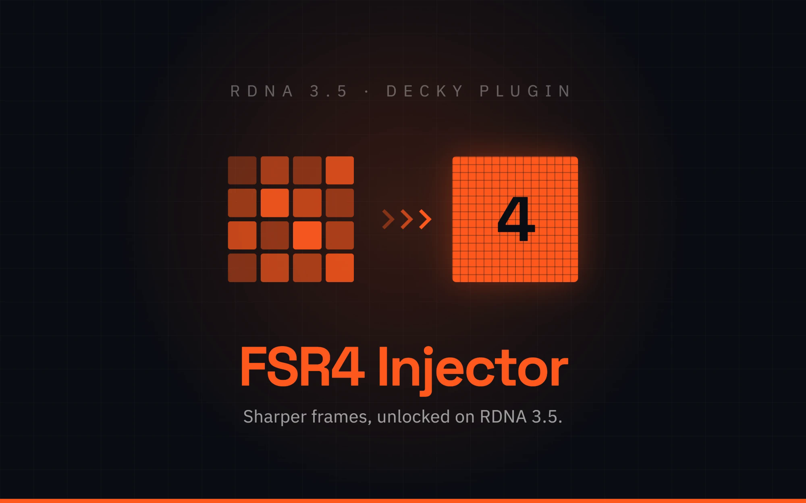
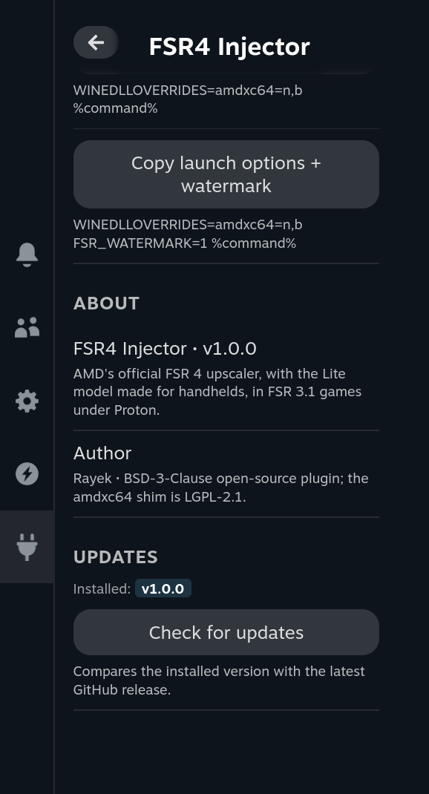
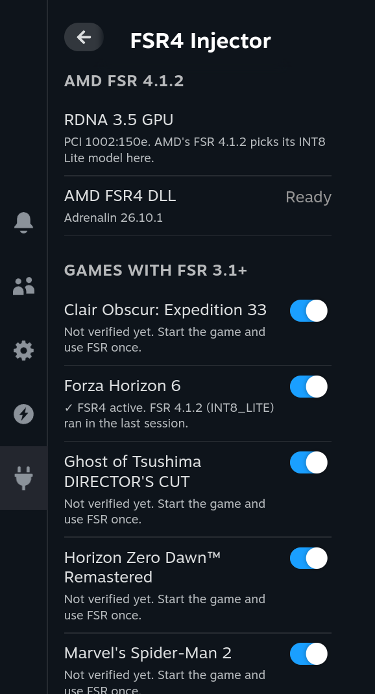
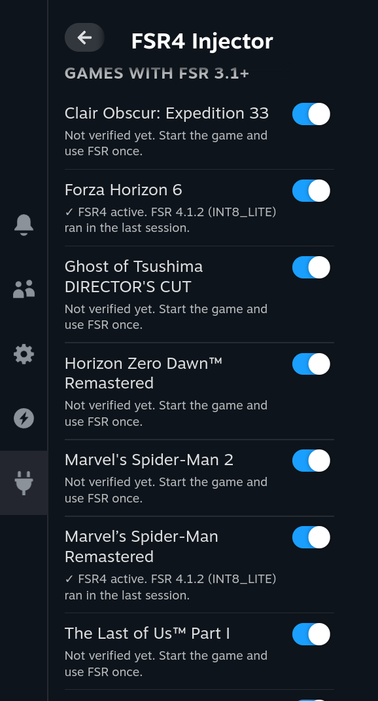
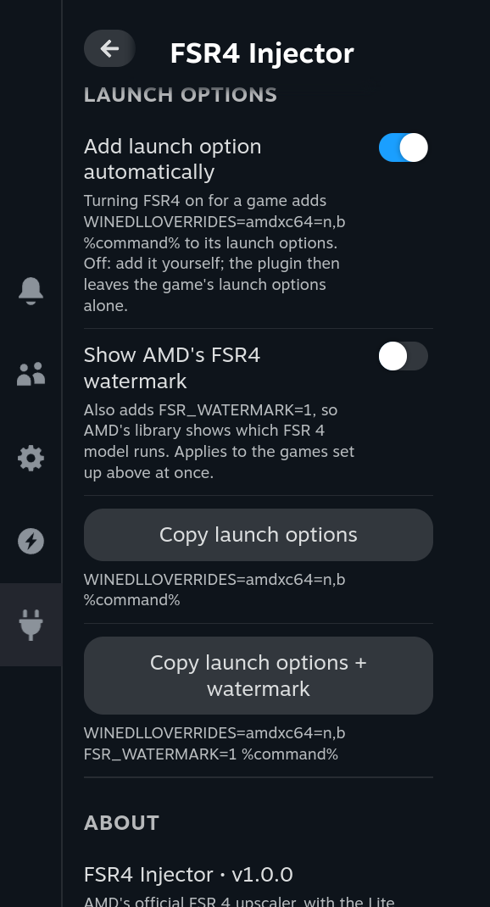

<div align="center">



[](https://github.com/Rayekkk/FSR4Injector/releases/latest)
[](https://github.com/Rayekkk/FSR4Injector/releases)
[-6E40C9?style=for-the-badge&labelColor=141417)](#requirements)
[](https://decky.xyz)
[](#license)

**AMD's official FSR 4.1 upscaler on your RDNA 3.5 handheld, in SteamOS Gaming Mode.**
Turn it on per game from the Quick Access Menu: AMD's own, unmodified FSR 4 library with the Lite model made for handhelds, in games that already use FSR 3.1. No OptiScaler, nothing patched on disk.

[Features](#features) · [Requirements](#requirements) · [Installation](#installation) · [Quick start](#quick-start) · [Troubleshooting](#troubleshooting) · [How it works](#how-it-works) · [AI disclaimer](#ai-disclaimer)

</div>

---

## Features

AMD brought FSR 4.1 to RDNA 3.5 APUs such as the Radeon 890M (Ryzen Z2 Extreme) on Windows in
October 2026. Under Proton the same library loads but quietly falls back to FSR 3, because it
identifies the GPU through Windows driver data that Wine does not have. FSR4 Injector supplies
that one missing answer and manages everything around it.

| Feature | What you get |
|---|---|
| **One-tap setup** | Fetches AMD's FSR 4 library straight from AMD's servers (about 43 MB) and checks it |
| **Per-game switch** | Lists your installed games that use FSR 3.1 or newer and turns FSR 4 on or off for each |
| **All at once** | **Turn on FSR4 in all games** sets up every compatible offline game; **Turn off FSR4 and restore all games** puts every one back |
| **Launch options your way** | Adds the one launch option it needs, or leaves launch options to you with ready-to-paste text; AMD's watermark on demand |
| **Never fails silently** | After every session it checks that FSR 4 really ran, and tells you when it did not and why |
| **Update aware** | Marks a game for a re-check after a SteamOS or Proton update and says what changed |
| **Clean rollback** | Turning a game off removes exactly what was added and puts its launch options back |
| **Updates** | **About → Check for updates** downloads a newer release from GitHub to your Downloads folder and checks it |

Measured on a Legion Go 2 (Spider-Man Remastered menu, 1920×1200, Quality): FSR 3 13.7 ms,
**FSR 4 Lite 14.1 ms, about 3% slower, with a clearly sharper image**, FSR 4's desktop INT8
model 15.1 ms. One run per variant.

## Requirements

| Requirement | Details |
|---|---|
| GPU | An AMD GPU that AMD's FSR 4.1.2 has a model for. **Verified:** Radeon 880M/890M (Strix Point: Ryzen Z2 Extreme, Ryzen AI 9 300) with the Lite model. **Beta, not tested yet:** Steam Deck and Ryzen Z2 A (Van Gogh, Lite), RX 6000 (RDNA2 model), RX 7000 and Strix Halo (INT8), RX 9000 (FP8) |
| System | SteamOS in Gaming Mode with [Decky Loader](https://decky.xyz); Proton 11 or Proton Experimental |
| Games | DirectX 12 games that ship `amd_fidelityfx_dx12.dll`, `amd_fidelityfx_upscaler_dx12.dll` or `amd_fidelityfx_loader_dx12.dll` (FSR 3.1 or newer) |
| Network | Once, to download AMD's library from `drivers.amd.com`; and when you check for plugin updates (GitHub) |

FSR 2, FSR 3.0 and Vulkan games are not supported. The panel shows which model AMD's library
will pick on your GPU; GPUs AMD has no model for, such as the Radeon 780M (Z1 Extreme), are
refused.

Adding DLLs to a game's folder can get you kicked or banned in online games, so:

- games with anti-cheat files (Easy Anti-Cheat, BattlEye, Vanguard, XIGNCODE, nProtect
  GameGuard, PunkBuster, EQU8) get a red warning under their switch;
- **Turn on FSR4 in all games** skips those games, games Steam lists as online (MMO,
  Cross-Platform Multiplayer, Online PvP or Online Co-op) and games Steam gives no categories
  for. Online games are marked in the list.

You can still turn any of them on one by one, at your own risk.

Each game gets its own copy of AMD's library, about 82 MB.

## Installation

1. Install [Decky Loader](https://decky.xyz) if you do not already have it.
2. Download `FSR4Injector-<version>.zip` from [Releases](https://github.com/Rayekkk/FSR4Injector/releases).
3. In Gaming Mode, open **Quick Access Menu → Decky → Settings**, turn on **Developer mode** under
   **General**, then open **Developer**.
4. Choose **Install Plugin from ZIP**, select the archive, then open **FSR4 Injector** in Decky.

### Updating

Open **About → Check for updates** at the bottom of the plugin. When a newer release is out,
**Download** saves its ZIP to your Downloads folder after checking it against the SHA-256 GitHub
publishes; install it the same way as above. Your games stay set up, and the plugin brings their
copy of its DLL up to date at the next start.

<a href="docs/screenshots/about.png"></a>

### Uninstalling

Press **Turn off FSR4 and restore all games** first. Decky handles an update as uninstall plus install, so
the plugin never removes anything from games on its own. If you skip this, FSR 4 keeps working
in those games, just without the plugin's checks. To clean up by hand, delete `amdxc64.dll`,
`amdxcffx64.dll`, `fsr4injector.gpu` and `fsr4injector.status.json` from the game's folder (next to
its `amd_fidelityfx_*.dll`) and remove `WINEDLLOVERRIDES=amdxc64=n,b` (and `FSR_WATERMARK=1`) from its
launch options.

## Quick start

<a href="docs/screenshots/overview.png"></a>

1. Open **FSR4 Injector** and press **Accept and download**. This fetches the FSR 4 library from
   AMD's official Adrenalin 26.10.1 package and accepts the
   [AMD Software EULA](https://www.amd.com/en/legal/eula/amd-software-eula.html).
2. Turn on a game under **Games with FSR 3.1+**.
3. Start the game and choose **AMD FSR** as its upscaler.
4. Quit the game. The panel shows **✓ FSR4 active**, or a notification tells you what went wrong.

<a href="docs/screenshots/games.png"></a>

| Status | Meaning |
|---|---|
| ✓ FSR4 active | FSR 4 ran in the last session; the model it used is shown |
| ↻ Re-check needed | SteamOS or Proton changed since FSR 4 last ran; play once to confirm |
| FSR not used last session | The game did not ask for FSR; pick AMD FSR in its graphics settings |
| ⚠ FSR4 not active | It should have run but did not; the reason is shown underneath |
| Not verified yet | The game has not been played since you turned it on |

### Launch options

**Add launch option automatically** (on by default) puts `WINEDLLOVERRIDES=amdxc64=n,b` in front of
a game's launch options when you turn it on. Turn it off if you manage launch options yourself:
the plugin then never touches them, and **Copy launch options** copies the text to paste.
**Show AMD's FSR4 watermark** also adds `FSR_WATERMARK=1`, so AMD's library draws which FSR 4
model runs; it changes the games already set up at once. **Copy launch options + watermark**
copies both.

<a href="docs/screenshots/launch-options.png"></a>

## Troubleshooting

| What you see | What to do |
|---|---|
| "The AMD DLL refused FSR4 and fell back to FSR3" | Usually a SteamOS or Proton update. Check for a plugin update |
| "…launch options no longer contain WINEDLLOVERRIDES…" | Another tool rewrote them. Turn the game off and on again |
| "GPU … is not supported by this plugin version" | The game's copy of the GPU details is missing or from another device. Turn the game off and on again |
| "FSR4 Injector's DLL was not loaded in this session" | The game did not start DirectX 12 (DirectX 11 mode, or closed in its launcher), or its launch option is missing |
| "This AMD DLL version is not recognised" | The plugin needs an update for a newer AMD library |
| "…already sets WINEDLLOVERRIDES…" | Turn off **Add launch option automatically** and add `amdxc64=n,b` to the game's existing override yourself, e.g. `WINEDLLOVERRIDES="dxgi=n,b;amdxc64=n,b" %command%` |
| "…already exists in the game folder and is not ours" | Another mod uses the same file name; FSR4 Injector leaves it alone |
| Download failed | Read the error and retry; the plugin keeps nothing from a failed download |

**Reporting a problem:** include the plugin version, SteamOS version, Proton version, the game
and what the panel says. [CHANGELOG.md](CHANGELOG.md) lists the changes in each version.

## How it works

<details>
<summary><b>The two DLLs, the download and the checks</b></summary>

Two files go next to the game's FidelityFX DLL, and `WINEDLLOVERRIDES=amdxc64=n,b` is added in
front of its launch options (without it Wine loads its own builtin `amdxc64` and ignores ours).

| File | What it is |
|---|---|
| `amdxcffx64.dll` | AMD's FSR 4 library (FidelityFX 2.4.0.4370, FSR 4.1.2), unmodified and signed by AMD |
| `amdxc64.dll` | This project's open-source stand-in for AMD's driver extension DLL, based on GE-Proton's |

AMD's library picks its model by asking the Windows kernel driver for the GPU family. Wine has
no answer, so every model is refused and FSR 3 stays. The plugin reads the GPU's real family and
revision from the Linux amdgpu driver (the values RADV reports, e.g. family 150, revision 20 on
the 890M) into `fsr4injector.gpu`, and the shim answers that one question with them. The library
then chooses its model by its own rules, as on Windows: Lite on RDNA 3.5 and Van Gogh APUs, its
RDNA2 model on RX 6000, INT8 on RX 7000 and Strix Halo. Nothing on disk is patched; AMD's
signature stays intact.

AMD's library is not part of the plugin. It ships only inside AMD's 1.7 GB Adrenalin installer,
compressed in a few large LZMA2 blocks. The plugin downloads only the stretch that starts at a
recorded restart point shortly before the DLL, decodes it on the fly and keeps the DLL only if
its SHA-256 matches. `npm run package` refuses to build a ZIP that contains any AMD file.

The shim writes `fsr4injector.status.json` next to the game: which model AMD's library
accepted, the Proton it ran under and when. After each session the plugin compares it with the
session's start time and the game's launch options, and remembers the SteamOS and Proton
versions FSR 4 last worked with.

Each game folder gets its own copy of AMD's library (about 82 MB), so turning a game off never
affects another. Files are only ever added. A file of the same name that is not ours stops the install; every
file written is recorded with its SHA-256 and removed only while it still matches. Proton
itself is not modified and nothing is installed system-wide.

</details>

## Development

<details>
<summary><b>Build, test and package from source</b></summary>

Requires Node.js 24, Python 3.10 or newer and, for the shim, MinGW-w64 (x86_64).

```bash
npm ci --ignore-scripts --no-audit --no-fund
npm run typecheck      # frontend types
npm run test:frontend  # panel regression tests
npm run test:backend   # Python backend tests
npm run build          # compile the frontend
bash shim/build.sh path/to/amdxcffx64.dll  # build bin/amdxc64.dll and run its self-test
npm run package        # create FSR4Injector-<version>.zip
```

Install the result through Decky's **Install Plugin from ZIP**. GitHub Actions runs the backend
tests on Linux and Windows, checks the frontend and the built ZIP, and compiles the shim. The
shim self-test runs on Windows against an AMD library you supply, so CI cannot run it. Steam,
Decky and AMD's server are mocked; game sessions still need testing on the handheld
(`tools/device/`). `tools/find_recipe.py` makes the download recipe for a new Adrenalin release.

</details>

---

## Credits

- **Etaash Mathamsetty** and [GE-Proton](https://github.com/GloriousEggroll/proton-ge-custom) - the `amdxc64` implementation the shim is based on
- [vkd3d-proton](https://github.com/HansKristian-Work/vkd3d-proton) - the D3D12 extensions the shim queries
- [OptiScaler](https://github.com/optiscaler/OptiScaler) - documenting how FSR 4 picks its model
- [Decky Loader](https://github.com/SteamDeckHomebrew/decky-loader) - the plugin platform

Component licenses are recorded in [NOTICE](NOTICE).

---

## License

Plugin code: BSD 3-Clause - see [LICENSE](LICENSE). `bin/amdxc64.dll` and `shim/`: LGPL-2.1 or
later - see [shim/COPYING.LIB](shim/COPYING.LIB). AMD software is not included and stays under
AMD's licence. Not affiliated with AMD or Valve.

---

## AI disclaimer

This project was built with substantial help from an AI coding assistant. The research, the
shim, the plugin, the tests and this documentation were written by Anthropic's Claude Code
working under my direction: I set the goal and the requirements (official AMD code only, no
silent failures, a safe rollback, nothing redistributed that may not be), made the decisions
and chose what was released.

The AI was used to:

- find out why FSR 4 stays off on RDNA 3.5 under Proton, by reading Proton's and GE-Proton's
  source and disassembling AMD's library;
- port GE-Proton's `amdxc64` to a standalone DLL and add the GPU answer and the status file;
- work out how to fetch AMD's library from AMD's own package without the full 1.7 GB download;
- write the Decky plugin, its tests and this documentation.

Nothing here is untested AI output. Every step was tested on my Legion Go 2 in Gaming Mode:
in Spider-Man Remastered, Spider-Man 2 and Clair Obscur: Expedition 33, on Proton 11 and Proton
Experimental, with AMD's watermark, deliberate failures, plugin updates and rollbacks.

FSR4 Injector places DLLs in your game folders. It is provided as is, without warranty (see
[License](#license)); use it at your own risk.
